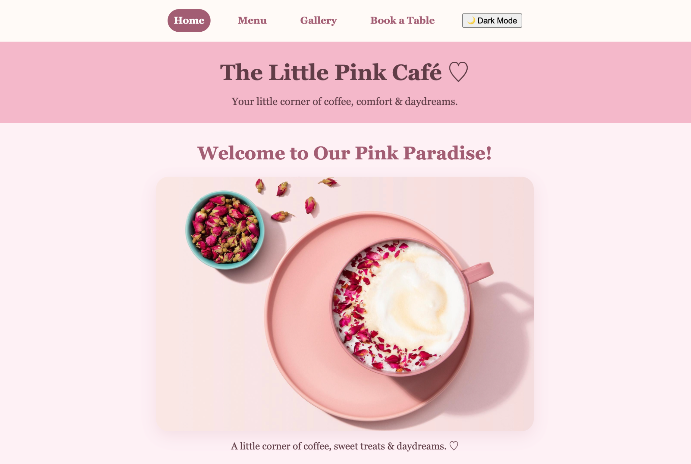
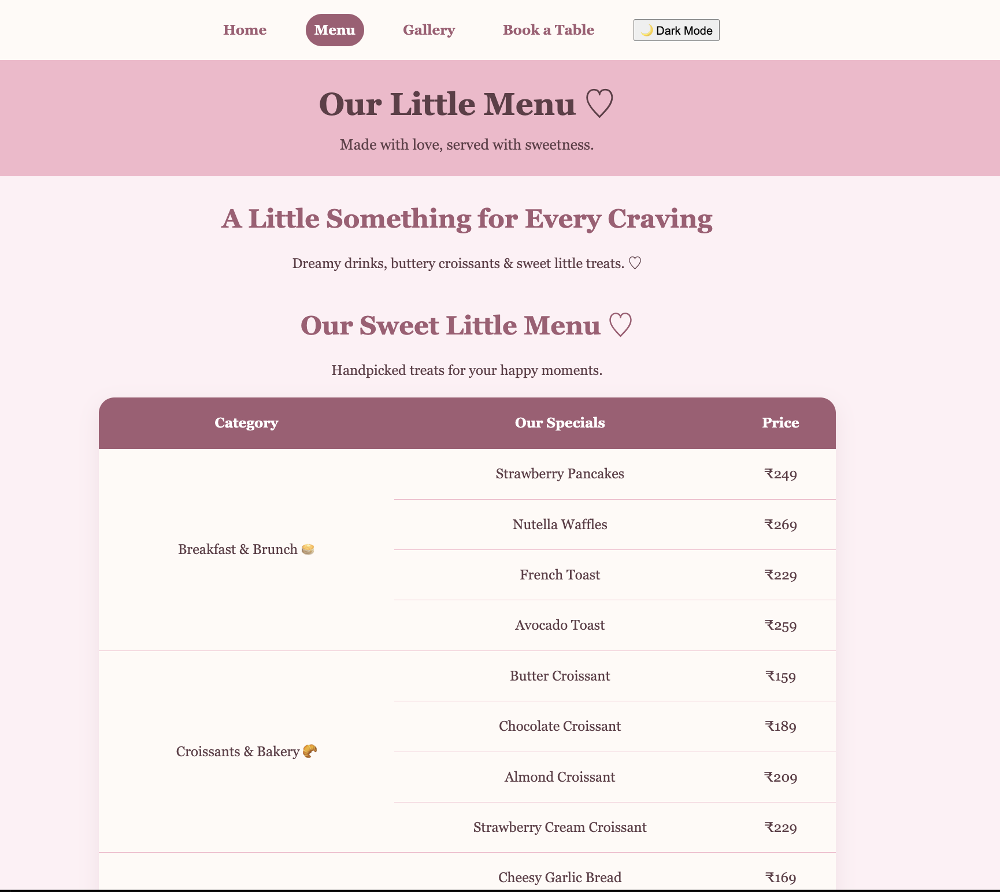
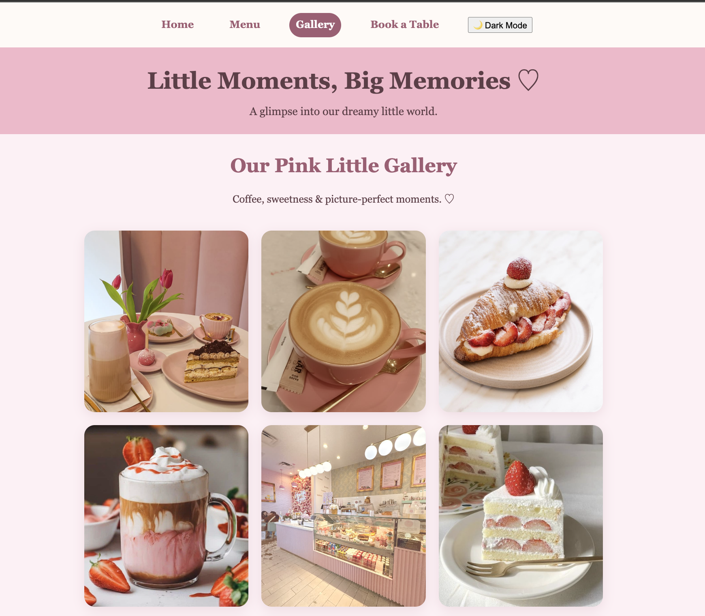
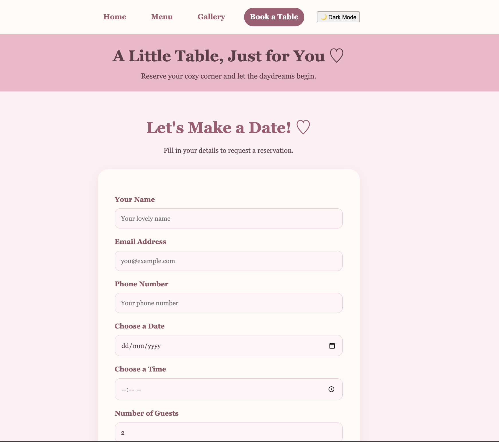

# The Little Pink Café ♡

A dreamy, pastel-pink, multi-page café website created as a Web Development college assignment.

## 🌸 Website Preview

### 🍓 Our Menu

### 🌷 Gallery Page

### 💌 Book a Table

## About the Project
The Little Pink Café is a cozy virtual café experience featuring a menu, photo gallery, and table booking form.

## Pages
- Home: Welcome section and café introduction.
- Menu: Food and drink items with prices in an HTML table.
- Gallery: A collection of café and food photographs.
- Book a Table: Reservation form and contact information.

## Features
- Responsive design for mobile and desktop
- Light and dark mode toggle
- Theme preference saved using localStorage
- Navigation between four pages
- HTML form validation
- Pastel-pink café-inspired design

## Technologies Used
- HTML5
- CSS3
- JavaScript

## How to Run
1. Download or clone this repository.
2. Open the project folder.
3. Open index.html in a web browser.

## Project Purpose
Created for a college Web Development assignment to demonstrate HTML, CSS, JavaScript, responsive layouts, and GitHub version control.

## Created By
Riya Jethwani

